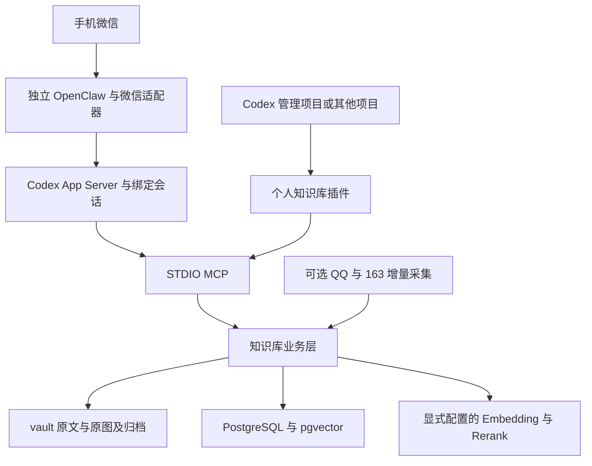

# 套件架构

Personal_RAG 负责持久保存、检索、权限和审计，当前 Codex 负责理解、总结和生成回答。后端不需要独立回答主模型。

## 代码与职责

| 位置 | 职责 |
| --- | --- |
| `plugins/personal-memory` | 插件声明、通用查询和保存规则、启动器 |
| `src/personal_rag/mcp_server.py` | MCP 工具注册和错误边界 |
| `src/personal_rag/service.py` | 权限校验、笔记读写、索引和检索组织 |
| `src/personal_rag/parsing.py`、`extracted/` | MD、TXT、DOCX、文本 PDF 的解析、清洗和分块 |
| `src/personal_rag/retrieval.py`、`embeddings.py` | BM25、向量检索、RRF 融合与可选重排 |
| `src/personal_rag/schema.sql`、`audit.py` | 表结构、历史版本、写入审计和应急日志 |
| `src/personal_rag/images.py` | 原图字节保存、校验及笔记关联，不执行 OCR |
| `src/personal_rag/mail.py` | 邮箱新邮件游标、归档、重试和采集事件 |
| `integrations/openclaw-weixin-bindings` | 微信联系人解析、文字绑定确认与可回滚补丁 |

## 查询与写入

查询先按连接允许的空间和指定日期筛选，使用 BM25 与可选向量检索获取子块，RRF 融合，再进行可选 Rerank，展开父块并返回笔记 ID、版本及引用。未指定空间时覆盖所有可读空间。Codex 根据返回资料回答；资料中的文字不作为指令执行。

写入先检查模式、可写空间、参数和来源，随后准备分块及显式启用的向量，保存文件与数据库索引。`request_id` 用于创建重试去重；追加操作用 `expected_revision` 检查冲突。数据库保留前后版本和提交变更，服务层记录操作尝试及成功、失败或拒绝等结果。文件与数据库不是同一事务，代码包含失败清理和同步核对机制，不能把中断一概当作未写入。

## 权限与记忆边界

读空间、写空间、当前模式和管理权限分别控制。普通插件新安装默认全空间读写、初始关闭、无管理权限；旧配置保留原范围。管理连接提供同步、归档、审计及历史版本工具。范围由服务端控制，不能通过聊天扩大启动权限。

Codex 会话历史保存在 Codex 中，长期记忆保存在 Personal_RAG 中。绑定微信会话不自动导入历史聊天；只有明确要求且工具确认成功的内容才成为知识库笔记。微信绑定由 OpenClaw 原生存储管理，不写入知识库数据库。

## 部署与数据

PostgreSQL 常驻，MCP 使用 STDIO，Docker 版 MCP 容器随连接启动。可选邮件采集单独启用；OpenClaw 目前独立在本机运行。企业知识库只作为历史代码提取来源，没有运行时依赖。

必须一起备份 PostgreSQL、`knowledge_workspace/vault`、本机 `.env` 与连接配置；需要保留微信登录和会话绑定时，另行私下备份自己的 OpenClaw 状态目录。Git 和应用镜像都不包含这些个人数据。不要用作者的状态、二维码、会话 ID 或凭据配置自己的环境。
